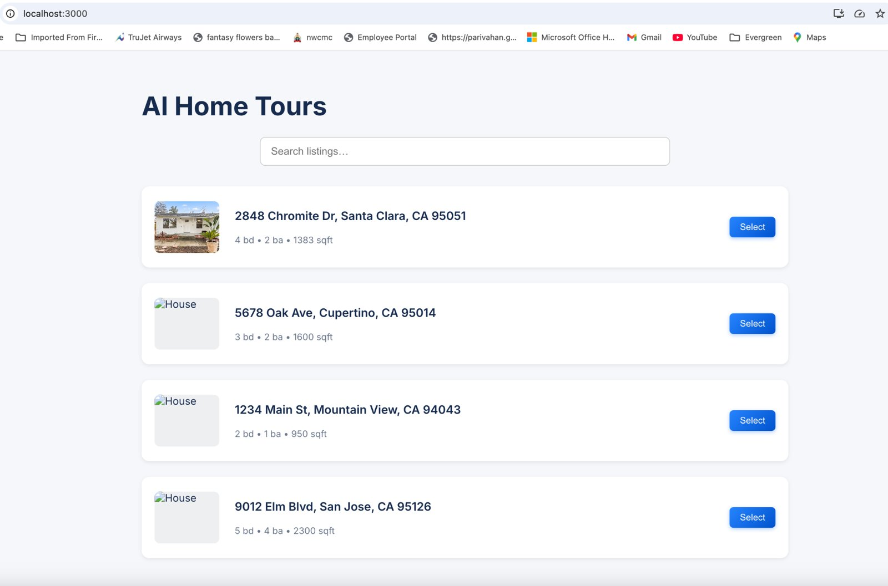
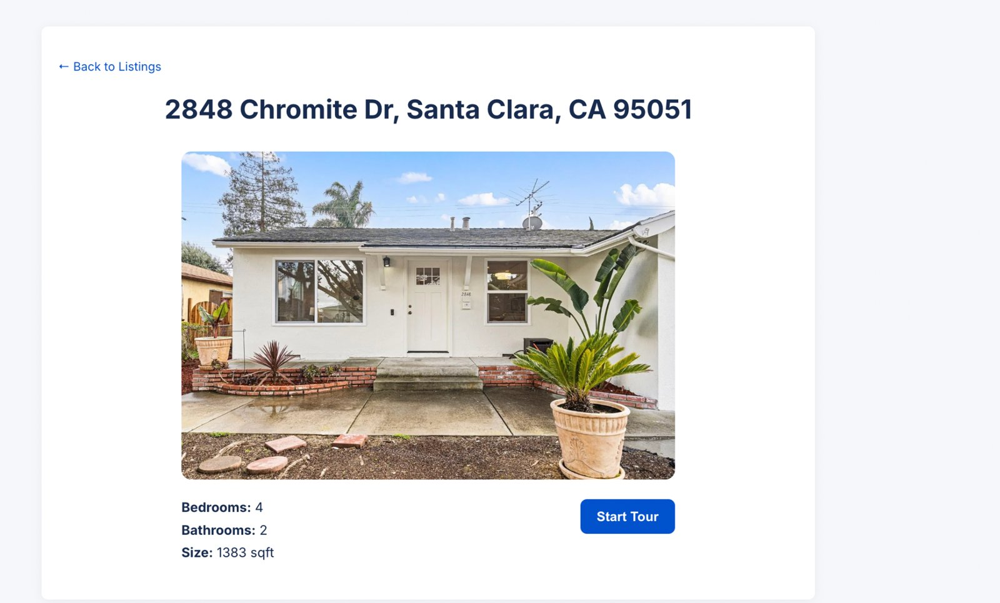
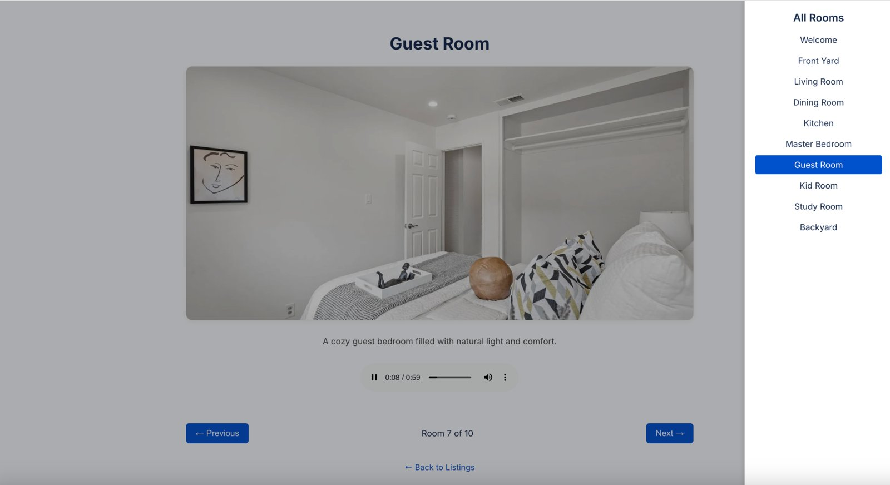
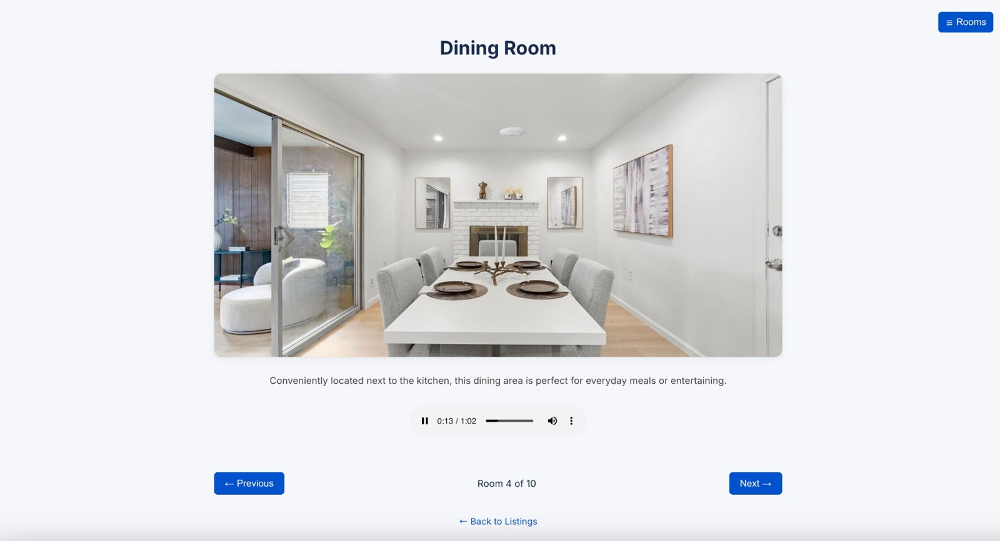
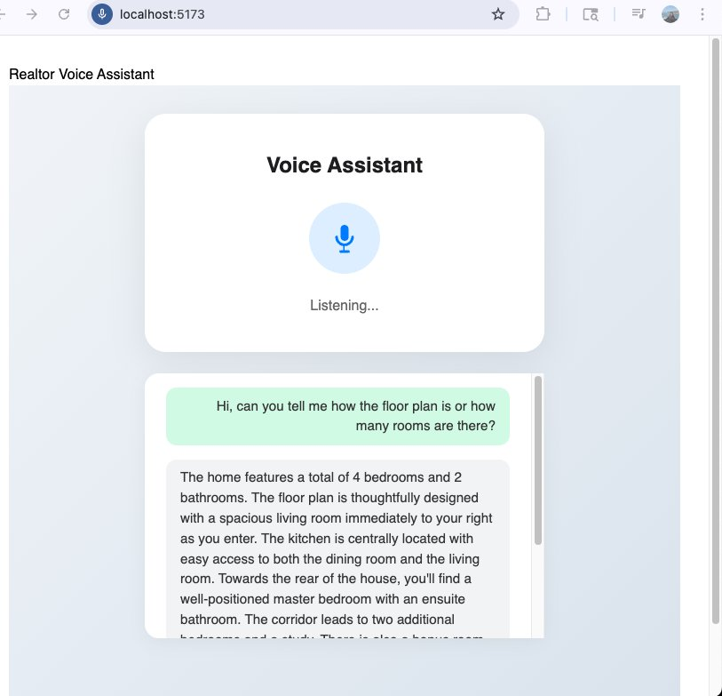
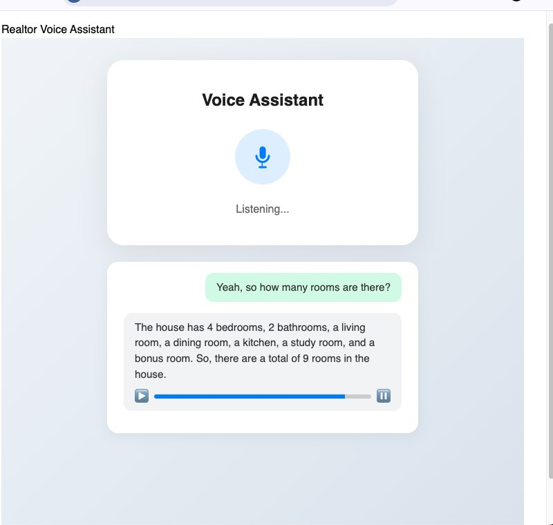
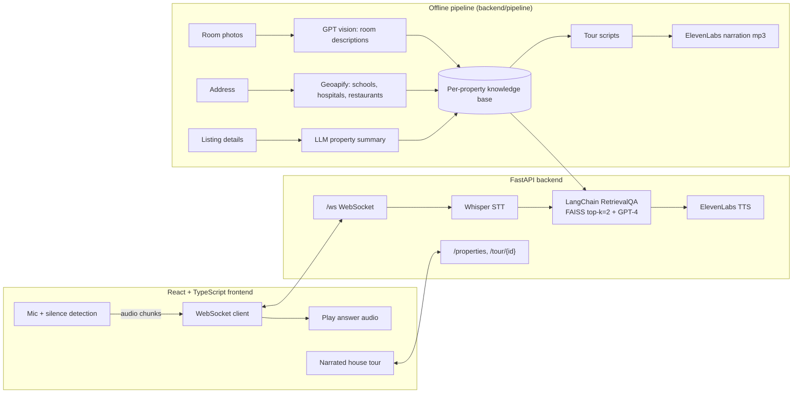
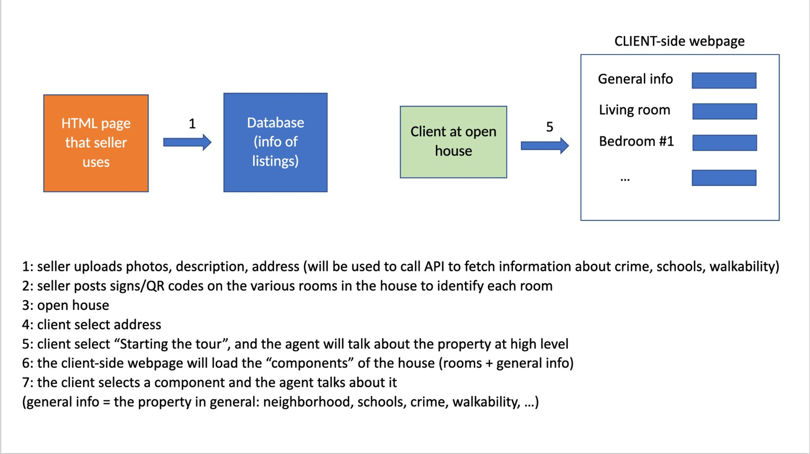
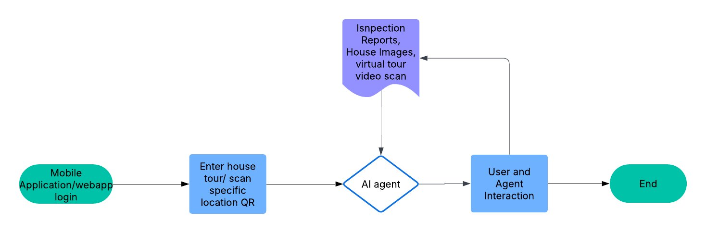
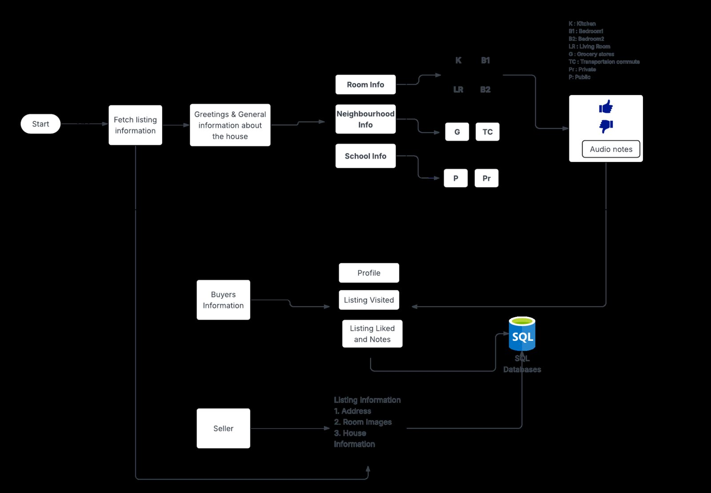

# AI Realtor Voice Assistant

A voice-first home-tour assistant. Buyers take a narrated, room-by-room tour of a listing and ask questions out loud ("How far is the nearest school?", "When was the kitchen remodeled?"). The assistant answers in a natural voice, grounded in that property's data using retrieval-augmented generation (RAG).

> Industry practicum project (Santa Clara University, M.S. Information Systems, 2025), built by a team of three for a voice-AI startup sponsor.
> **My role: backend and AI pipeline.** FastAPI server, real-time WebSocket voice loop, speech-to-text, RAG question answering, text-to-speech, and the offline knowledge-base generation pipeline.

## Demo

▶️ **[Watch the demo video](docs/demo/RealtorAppDemo.mp4)** (2.5 min, click "View raw" or download if it does not play inline).

The app has two parts: **AI Home Tours** (a guided, narrated room-by-room tour) and the **Realtor Voice Assistant** (hands-free spoken Q&A about the property).

### AI Home Tours

| Pick a listing | Property detail and "Start Tour" |
|---|---|
|  |  |
| **Room menu**, from the front yard to the backyard | **Narration starts automatically** when a room is selected (Next or the room menu) |
|  |  |

### Realtor Voice Assistant

| "How many rooms are in the house?" | "Tell me about the floor plan" |
|---|---|
|  |  |

Example questions it handles: "What type of restaurants are there nearby?", "How many rooms are in the house?", "Describe the floor plan."

## The problem

Online listings are static: photos and a block of text. Buyers still have to call an agent for basic questions about the neighborhood, schools, commute or renovation history, and agents spend hours answering the same questions for every listing.

We started with interviews of home buyers (friends who had recently bought) about their house-hunting experience, and grouped the questions they had into three phases of the journey:

| Phase | What buyers are trying to do | Typical questions |
|---|---|---|
| **1. Initial** | Understand the basics and set a budget | Which house type suits my lifestyle? Rent vs. buy? Which areas have good public or private schools? How does the loan process work, and what would my monthly payment be? |
| **2. House touring** | Shortlist and visit homes | What schools are nearby and how are they rated? Is the neighborhood safe or noisy? What transport is close? How big is each room? When was it last renovated? |
| **3. Commitment** | Decide and bid | What is a reasonable bid? Can you summarize the inspection report? Why is the owner selling? What closing costs, HOA fees and property tax should I expect? |

We also listed seller-side questions (pricing, staging, offers, closing costs) as a possible later scope.

### Focus: pain points during the house tour

We chose to focus on the **house tour**, where buyers are physically in the home and have the fewest ways to get answers:

| Pain point | What goes wrong |
|---|---|
| **No personal attention** | At open houses many visitors share one agent, so one-on-one time is limited and the agent is often rushed. |
| **No context while touring** | Nobody to ask "why are there so many solar panels in the garage?", "what is this leak in the pipes?", "why is the roof cracked?" or "what is behind that locked door?" |
| **Missing documentation** | Renovation history, permits, HOA rules and monthly fees are not available on the spot, and there is nothing to take home. |
| **Reliance on memory** | Buyers jot down square footage and observations by hand and forget which house had what, especially when photos are not allowed. |
| **Unanswered safety and utility questions** | No clear crime, noise or air-quality information, and no estimate of utility bills or maintenance costs. |
| **Square footage and layout** | Unclear square footage, no per-room dimensions or floor plan, and no way to compare rooms across homes. |
| **Outdoor space, garage and orientation** | Backyard size, sunlight, fencing, drainage, garage dimensions, EV outlets and the direction the house faces are rarely stated. |

## Purpose and scope

Build a voice-enabled AI assistant that guides prospective buyers through an immersive, informative property tour, similar to a museum audio guide, and lets them ask questions out loud as they go. The goals:

1. Automate narrated home tours from room images, floor plans and property descriptions.
2. Enable natural voice interaction for buyer questions during the tour.
3. Reduce dependency on a physical agent being present, while improving engagement.

**How the assistant answers each pain point**

| Buyer pain point | Feature |
|---|---|
| Multiple visitors, hard to get attention | A personal AI guide on the buyer's own phone or laptop for self-paced touring |
| Waiting to talk to the agent | Real-time voice interface that answers common questions immediately |
| Nobody to answer specific questions | Answers grounded in the listing's own data (RAG) instead of guesses |
| Cannot measure rooms or recall details | Room descriptions and layout from floor plans and photos; observations and notes are planned (see below) |
| Safety, schools, amenities unknown | Neighborhood data pulled in at build time (schools, hospitals, restaurants) and searchable by voice |

**Benefits for the sponsor (Awaazai, a voice-first AI studio):** 24/7 virtual tours without an agent, many simultaneous tours across listings, a better buyer experience, and a differentiator in digital-first real estate.

## How it works



**1. Offline: build a knowledge base for each listing** (`backend/pipeline/`)
- `knowledgebase.py` turns room photos into tour-style descriptions with a GPT vision model, summarizes the listing details, and pulls nearby schools, hospitals and restaurants from the Geoapify Places API (`neighborhooddata.py`).
- `generate_room_scripts.py` writes a short, friendly narration script per room, and `generate_audio_from_text.py` converts each script to speech with ElevenLabs.

**2. Online: the tour and real-time Q&A** (`backend/main.py`)
- REST endpoints serve the listings and the tour (room images, descriptions, narration audio).
- A WebSocket endpoint receives microphone audio from the browser, transcribes it with **Whisper**, and answers it with a **LangChain RetrievalQA** chain over a per-property **FAISS** index (built on first use from the knowledge-base files). The answer is converted to speech with **ElevenLabs** and streamed back as base64 audio.
- The prompt restricts the LLM to the retrieved context and 3–4 sentences, so answers stay grounded and short enough to speak.

## Design decisions

| Decision | Why |
|---|---|
| **Voice loop: speech-to-text, then LLM, then text-to-speech** over a **WebSocket** | Buyers talk while walking, so the exchange has to feel like a conversation. One persistent connection streams microphone audio up and answer audio back without page reloads. Silence detection on the browser side starts a question automatically, so the buyer never presses a button. |
| **RAG over a per-property knowledge base** (LangChain + FAISS) | A general LLM would guess about a specific house. Retrieving from that listing's own data keeps answers about rooms, schools and renovations grounded, and each property gets its own index so listings never mix. |
| **Short, context-only answers** (3-4 sentences) | Answers are spoken, not read. Short answers are easier to follow while walking and faster to synthesize. |
| **Generate the knowledge base and tour narration offline** | Room photos, listing details and neighborhood data are processed once per listing (GPT vision, Geoapify, an LLM summary), and narration audio is pre-generated. The tour then starts instantly and live API calls are reserved for questions. Audio needs to load within a few seconds. |
| **Enrich listings with neighborhood data** | Buyers' most common questions in the research were about schools, safety, transport and nearby amenities, which listings rarely include. |
| **Room-by-room tour with a room menu and "Next"** | Gives the buyer control: follow the sequence, or jump to a room. Narration starts automatically when a room is selected. |
| **Voice quality via ElevenLabs** | The tour is meant to feel like a human guide, so narration scripts are written in a friendly, spoken style and rendered with a natural voice. |
| **Start with the house tour, not the whole buyer journey** | The research covered research, touring, bidding and selling, but the tour is where buyers have the fewest answers, so it was the focus for the MVP. |

## Functional requirements (summary)

From the functional requirements document: users are **home buyers**, **realtors** (admin/editor) and **sellers** (property data providers).

- Show a list of available house tours and let the user pick a property.
- Clickable rooms plus an audio chat interface; audio plays when a room is selected, with pause, replay and skip, and autoplay through the tour.
- Admin tools for sellers to upload photos and descriptions, generate audio with TTS, and edit content.
- Non-functional targets: audio loads within a few seconds, role-based access, 100+ simultaneous users, and a clear error with retry if audio fails to load.
- Acceptance criteria: a user can listen to at least 5 rooms without errors, and an admin can add a new property and generate its audio in under 10 minutes.

## Design vs. what the MVP covers

The design documents describe a broader product than the prototype. The prototype delivers the guided tour and the voice Q&A end to end.

| Area | In the design | In the prototype |
|---|---|---|
| Guided narrated tour, room menu, autoplay | Yes | Yes |
| Real-time voice Q&A grounded in the listing (RAG) | Yes | Yes |
| Neighborhood enrichment (schools, hospitals, restaurants) | Yes | Yes |
| Location-aware playback with QR codes on rooms or floor-plan mapping | Planned | Planned |
| Login, buyer/realtor/seller roles, seller upload tool | Planned | Planned |
| Inspection-report summaries as a data source | Planned | Planned |
| Saved notes, likes and post-tour review, session analytics (PostgreSQL) | Planned | Planned |
| Mobile app (React Native) and multilingual support | Planned | Planned |

## Product flow

The intended flow: the seller uploads photos, description and address (the address is used to fetch crime, schools and walkability data); the buyer opens the listing, starts the tour, and the agent introduces the property and then talks about whichever component (general info, living room, bedroom) the buyer selects.







## Project documents

The planning and research documents from the project are in [`docs/project-documents/`](docs/project-documents/):

- [Project Summary Report](docs/project-documents/Project_Summary_Report.docx) (also available as [`docs/project-report.pdf`](docs/project-report.pdf))
- [Pain Points in Real Estate](docs/project-documents/Pain_Points_in_Real_Estate.docx): buyer interview notes, journey questions and house-tour pain points
- [Functional Design Document](docs/project-documents/Functional_Design_Document.docx)
- [Functional Requirements Document](docs/project-documents/Functional_Requirements_Document.docx)
- [Tech Stack and Application Flow](docs/project-documents/Tech_Stack_and_Application_Flow.docx)
- [Product Flowchart](docs/project-documents/Product_Flowchart.docx) and [Flow Diagram](docs/project-documents/Flow_Diagram.docx)

## Tech stack

| Layer | Tools |
|---|---|
| Backend API | Python, FastAPI, WebSockets, Uvicorn |
| RAG | LangChain, FAISS, OpenAI embeddings, GPT-4 |
| Speech | OpenAI Whisper (STT), ElevenLabs (TTS) |
| Data enrichment | GPT vision, Geoapify Places API, geopy |
| Frontend | React, TypeScript, MediaRecorder API (built by teammates) |

## Project structure

```
backend/
  main.py                   # FastAPI app: REST + /ws voice endpoint
  RealtorAssistantRag.py    # per-property FAISS index + RetrievalQA chain
  speech_to_text.py         # Whisper transcription
  text_to_speech.py         # ElevenLabs synthesis
  pipeline/                 # offline knowledge-base + narration generation
frontend/                   # React + TypeScript UI
data/properties/            # sample listing (Property101) with images, scripts, narration
docs/                       # report, research and design documents, screenshots, demo video
```

## Run it locally

**Prerequisites:** Python 3.10+, Node 18+, and API keys for OpenAI, ElevenLabs and Geoapify (Geoapify is only needed for the offline pipeline).

```bash
# 1. Backend
cd backend
python -m venv venv && source venv/bin/activate
pip install -r requirements.txt
cp .env.example .env              # then add your API keys
uvicorn main:app --reload --port 8000

# 2. Frontend (new terminal)
cd frontend
npm install
npm start                         # opens http://localhost:3000
```

Open a listing, start the tour, then click the mic and ask a question about the property.

**Optional: regenerate the knowledge base for a property**
```bash
cd backend/pipeline
python knowledgebase.py Property101       # room descriptions, property + neighborhood summaries
python generate_room_scripts.py           # narration scripts
python generate_audio_from_text.py        # narration audio
```

## Results

- End-to-end MVP: narrated tours plus spoken Q&A grounded in listing data, running in the browser.
- <!-- TODO: add measured numbers, e.g. average voice round-trip latency (speech in → audio out), # of test questions answered correctly -->

## What I'd improve next

- **Evaluation:** a labeled set of buyer questions per listing to measure retrieval hit rate and answer faithfulness.
- **Latency:** stream LLM tokens straight into streaming TTS instead of waiting for the full answer.
- **Config and deployment:** move the frontend's `localhost:8000` URLs into environment config, add Docker and deploy a live demo.

## Team

Maheshwari Bhandare · Kamya Krishnan · Trupti Lone. Faculty advisor: Prof. Michele Samorani, Santa Clara University.
