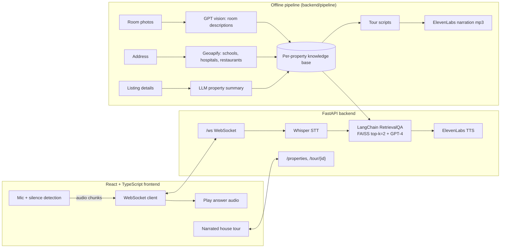

# AI Realtor Voice Assistant

A voice-first home-tour assistant. Buyers take a narrated, room-by-room tour of a listing and ask questions out loud ("How far is the nearest school?", "When was the kitchen remodeled?"). The assistant answers in a natural voice, grounded in that property's data using retrieval-augmented generation (RAG).

> Industry practicum project (Santa Clara University, M.S. Information Systems, 2025), built by a team of three for a voice-AI startup sponsor.
> **My role: backend and AI pipeline.** FastAPI server, real-time WebSocket voice loop, speech-to-text, RAG question answering, text-to-speech, and the offline knowledge-base generation pipeline.

## Demo

<!-- Upload the demo video to YouTube (unlisted is fine) and replace the link below, or add a GIF to docs/ -->
▶️ **[Watch the demo](#)**

<!--  -->

## The problem

Online listings are static: photos and a block of text. Buyers still have to call an agent for basic questions about the neighborhood, schools, commute or renovation history. Agents spend hours answering the same questions for every listing.

## How it works



**1. Offline: build a knowledge base for each listing** (`backend/pipeline/`)
- `knowledgebase.py` turns room photos into tour-style descriptions with a GPT vision model, summarizes the listing details, and pulls nearby schools, hospitals and restaurants from the Geoapify Places API (`neighborhooddata.py`).
- `generate_room_scripts.py` writes a short, friendly narration script per room, and `generate_audio_from_text.py` converts each script to speech with ElevenLabs.

**2. Online: the tour and real-time Q&A** (`backend/main.py`)
- REST endpoints serve the listings and the tour (room images, descriptions, narration audio).
- A WebSocket endpoint receives microphone audio from the browser, transcribes it with **Whisper**, and answers it with a **LangChain RetrievalQA** chain over a per-property **FAISS** index (built on first use from the knowledge-base files). The answer is converted to speech with **ElevenLabs** and streamed back as base64 audio.
- The prompt restricts the LLM to the retrieved context and 3–4 sentences, so answers stay grounded and short enough to speak.

## Tech stack

| Layer | Tools |
|---|---|
| Backend API | Python, FastAPI, WebSockets, Uvicorn |
| RAG | LangChain, FAISS, OpenAI embeddings, GPT-4 |
| Speech | OpenAI Whisper (STT), ElevenLabs (TTS) |
| Data enrichment | GPT vision, Geoapify Places API, geopy |
| Frontend | React, TypeScript, MediaRecorder API (built by teammates) |

## Project structure

```
backend/
  main.py                   # FastAPI app: REST + /ws voice endpoint
  RealtorAssistantRag.py    # per-property FAISS index + RetrievalQA chain
  speech_to_text.py         # Whisper transcription
  text_to_speech.py         # ElevenLabs synthesis
  pipeline/                 # offline knowledge-base + narration generation
frontend/                   # React + TypeScript UI
data/properties/            # sample listing (Property101) with images, scripts, narration
docs/                       # project presentation
```

## Run it locally

**Prerequisites:** Python 3.10+, Node 18+, and API keys for OpenAI, ElevenLabs and Geoapify (Geoapify is only needed for the offline pipeline).

```bash
# 1. Backend
cd backend
python -m venv venv && source venv/bin/activate
pip install -r requirements.txt
cp .env.example .env              # then add your API keys
uvicorn main:app --reload --port 8000

# 2. Frontend (new terminal)
cd frontend
npm install
npm start                         # opens http://localhost:3000
```

Open a listing, start the tour, then click the mic and ask a question about the property.

**Optional: regenerate the knowledge base for a property**
```bash
cd backend/pipeline
python knowledgebase.py Property101       # room descriptions, property + neighborhood summaries
python generate_room_scripts.py           # narration scripts
python generate_audio_from_text.py        # narration audio
```

## Results

- End-to-end MVP: narrated tours plus spoken Q&A grounded in listing data, running in the browser.
- <!-- TODO: add measured numbers, e.g. average voice round-trip latency (speech in → audio out), # of test questions answered correctly -->

## What I'd improve next

- **Evaluation:** a labeled set of buyer questions per listing to measure retrieval hit rate and answer faithfulness.
- **Latency:** stream LLM tokens straight into streaming TTS instead of waiting for the full answer.
- **Config and deployment:** move the frontend's `localhost:8000` URLs into environment config, add Docker and deploy a live demo.

## Team

Maheshwari Bhandare · Kamya Krishnan · Trupti Lone. Faculty advisor: Prof. Michele Samorani, Santa Clara University.
